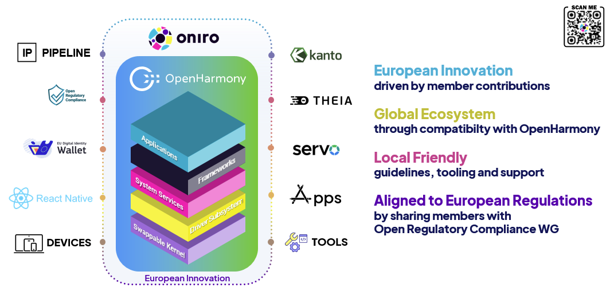

# Eclipse Oniro for OpenHarmony

**Oniro** is an Eclipse Foundation Project dedicated to developing an open source, vendor-neutral Operating System (OS) platform. Established through collaboration between the Eclipse Foundation and the OpenAtom Foundation, Oniro leverages **OpenHarmony** to build a versatile OS for a wide range of smart devices.

This project aims to build a global ecosystem of connected devices by extending the OpenHarmony platform with functionalities tailored for global markets, prioritizing interoperability, application ecosystem expansion and device support.

## Repository Overview

### Hardware Enablement

Board Support Packages (BSP), Vendor layers, and SoC support.

| Repository | Description |
| --- | --- |
| [device_board_oniro](https://github.com/eclipse-oniro4openharmony/device_board_oniro) | Oniro board support packages. |
| [device_soc_oniro](https://github.com/eclipse-oniro4openharmony/device_soc_oniro) | Oniro SoC support packages. |
| [vendor_oniro](https://github.com/eclipse-oniro4openharmony/vendor_oniro) | Oniro vendor support packages. |
| [device_board_rpi](https://github.com/eclipse-oniro4openharmony/device_board_rpi) | Raspberry Pi 4B board support packages (Fork). |
| [device_soc_broadcom](https://github.com/eclipse-oniro4openharmony/device_soc_broadcom) | Raspberry Pi SoC support packages (Fork). |
| [vendor_iscas](https://github.com/eclipse-oniro4openharmony/vendor_iscas) | Raspberry Pi 4B vendor support packages (Fork). |

### Build, Infrastructure & Tools

Tools for building, packaging, CI/CD, and IDE integration.

| Repository | Description |
| --- | --- |
| [meta-openharmony](https://github.com/eclipse-oniro4openharmony/meta-openharmony) | Yocto OpenEmbedded layer for building Oniro/OpenHarmony images. |
| [manifest](https://github.com/eclipse-oniro4openharmony/manifest) | Repo manifest files for the project. |
| [oniro-ide](https://github.com/eclipse-oniro4openharmony/oniro-ide) | IDE resources and configuration. |
| [oniro-vscode-ext](https://github.com/eclipse-oniro4openharmony/oniro-vscode-ext) | VSCode Extension for Oniro application development. |
| [oniro-app-builder](https://github.com/eclipse-oniro4openharmony/oniro-app-builder) | Tool for building Oniro/OpenHarmony applications. |
| [hub-mirror-action](https://github.com/eclipse-oniro4openharmony/hub-mirror-action) | GitHub Action for mirroring repos between GitHub and Gitee. |

### Core Services & Middleware

Platform extensions, third-party integrations, and app store services.

| Repository | Description |
| --- | --- |
| [third_party_kanto](https://github.com/eclipse-oniro4openharmony/third_party_kanto) | Kanto integration for Oniro. |
| [third_party_mosquitto](https://github.com/eclipse-oniro4openharmony/third_party_mosquitto) | Fork of Eclipse Mosquitto for Oniro integration. |
| [f-oh](https://github.com/eclipse-oniro4openharmony/f-oh) | Fork of F-OH application store for Oniro. |
| [f-oh-data](https://github.com/eclipse-oniro4openharmony/f-oh-data) | Fork of F-OH backend for Oniro. |

### Applications

Demos, utilities, and sample applications built for Oniro.

| Repository | Description |
| --- | --- |
| [app-bmicalculator](https://github.com/eclipse-oniro4openharmony/app-bmicalculator) | BMI calculator utility. |
| [app-discord](https://github.com/eclipse-oniro4openharmony/app-discord) | Discord application. |
| [app-duolingo](https://github.com/eclipse-oniro4openharmony/app-duolingo) | Duolingo application. |
| [app-gmail](https://github.com/eclipse-oniro4openharmony/app-gmail) | Gmail application. |
| [app-GoldenREP](https://github.com/eclipse-oniro4openharmony/app-GoldenREP) | Smartwatch app for evaluating weightlifting reps via AI. |
| [app-GuessNumber](https://github.com/eclipse-oniro4openharmony/app-GuessNumber) | Interactive number guessing game. |
| [app-HeartRateMonitor](https://github.com/eclipse-oniro4openharmony/app-HeartRateMonitor) | Wearable application for heart rate monitoring. |
| [app-Magic8Ball](https://github.com/eclipse-oniro4openharmony/app-Magic8Ball) | Magic 8 ball simulation. |
| [app-math_practice_demo](https://github.com/eclipse-oniro4openharmony/app-math_practice_demo) | Math problems practice application. |
| [app-MyList](https://github.com/eclipse-oniro4openharmony/app-MyList) | Organization and tracking application. |
| [app-MyMeteo](https://github.com/eclipse-oniro4openharmony/app-MyMeteo) | Weather forecast client (OpenMeteo). |
| [app-NfcDemo](https://github.com/eclipse-oniro4openharmony/app-NfcDemo) | NFC demo implementing read/write and Host Card Emulation. |
| [app-oh-ble](https://github.com/eclipse-oniro4openharmony/app-oh-ble) | BLE GATT client/server demo. |
| [app-oniroGPT](https://github.com/eclipse-oniro4openharmony/app-oniroGPT) | GPT client for the Oniro platform. |
| [app-OniroNews](https://github.com/eclipse-oniro4openharmony/app-OniroNews) | Personalized news application. |
| [app-Pinwheel](https://github.com/eclipse-oniro4openharmony/app-Pinwheel) | Interactive application simulating a pinwheel using breath input. |
| [app-PlayScout](https://github.com/eclipse-oniro4openharmony/app-PlayScout) | App to explore and download free games. |
| [app-PokemonList](https://github.com/eclipse-oniro4openharmony/app-PokemonList) | Reference app for Pokémon attributes. |
| [app-QuoteOfTheDay](https://github.com/eclipse-oniro4openharmony/app-QuoteOfTheDay) | Inspirational quote generator. |
| [app-rnoh-example](https://github.com/eclipse-oniro4openharmony/app-rnoh-example) | Example React Native application. |
| [app-smartGesture](https://github.com/eclipse-oniro4openharmony/app-smartGesture) | Wearable app demonstrating gestures and crown interactions. |
| [app-snake](https://github.com/eclipse-oniro4openharmony/app-snake) | Distributed Snake Game demonstrating distributed control. |
| [app-SuperBrightFlashlight](https://github.com/eclipse-oniro4openharmony/app-SuperBrightFlashlight) | Flashlight application. |
| [app-SuperDeviceDemo](https://github.com/eclipse-oniro4openharmony/app-SuperDeviceDemo) | Cross-device sync demo using distributed KV store. |
| [app-ThrowTheDice](https://github.com/eclipse-oniro4openharmony/app-ThrowTheDice) | Helper app for RPG/board games. |
| [app-TimeAroundWorld](https://github.com/eclipse-oniro4openharmony/app-TimeAroundWorld) | Multi-timezone clock showcase. |
| [app-unitconverter](https://github.com/eclipse-oniro4openharmony/app-unitconverter) | Measurement conversion tool. |
| [app-WaterTracker](https://github.com/eclipse-oniro4openharmony/app-WaterTracker) | Hydration tracking application. |
| [app-wikipedia](https://github.com/eclipse-oniro4openharmony/app-wikipedia) | Wikipedia application. |
| [app-WorkoutLogbook](https://github.com/eclipse-oniro4openharmony/app-WorkoutLogbook) | Workout and health management tracker. |
| [app-youtube](https://github.com/eclipse-oniro4openharmony/app-youtube) | YouTube application. |

### Documentation & Project Management

| Repository | Description |
| --- | --- |
| [eclipse-oniro4openharmony.github.io](https://github.com/eclipse-oniro4openharmony/eclipse-oniro4openharmony.github.io) | Source for the Oniro Documentation website. |
| [oniro-planning](https://github.com/eclipse-oniro4openharmony/oniro-planning) | Oniro development planning and discussions. |
| [.github](https://github.com/eclipse-oniro4openharmony/.github) | Organization default configuration. |

## Get Involved

We welcome contributions from developers, researchers, and enthusiasts.

* **Contribute:** Submit code, ideas, or documentation to the repositories linked above.
* **Weekly Calls:** Join us every Thursday. [Google Calendar](https://calendar.google.com/calendar/embed?src=c_d73vnjj36rufvora32gdfc8508%40group.calendar.google.com&ctz=Europe%2FParis) | [iCal](https://calendar.google.com/calendar/ical/c_d73vnjj36rufvora32gdfc8508%40group.calendar.google.com/public/basic.ics)
* **Discuss:** Join the community on our [Matrix Channels](https://chat.eclipse.org/#/room/#oniro:matrix.eclipse.org).

## Related Resources

* [Oniro Project Website](https://oniroproject.org)
* [Oniro Documentation](https://docs.oniroproject.org/)
* [OpenHarmony Project](https://www.openharmony.cn/)
* [Eclipse Foundation](https://www.eclipse.org/)
